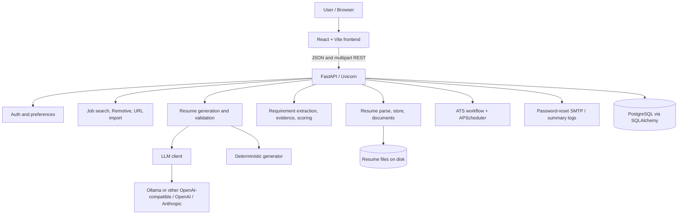
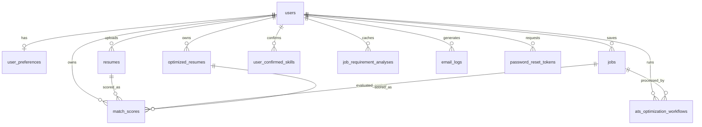

# CareerBoost AI

AI-powered job search, ATS resume optimization, and career workflow platform.

CareerBoost AI is a full-stack application for discovering jobs, analyzing a resume against a job description, confirming skill evidence, generating a truthful optimized resume, editing it, and comparing original vs. optimized ATS scores. It is implemented as a React SPA talking to a FastAPI backend with PostgreSQL persistence.

The core problem it addresses is keyword-only resume tailoring: adding JD terms without checking whether the candidate actually has supporting experience. CareerBoost separates employer requirements from candidate evidence, lets the user confirm or deny uncertain skills, and constrains generated content to the uploaded resume plus accepted user-confirmed evidence. Scores are internal compatibility estimates, not scores from an employer or commercial ATS.

The optimizer is role-family based rather than hardcoded to one job title. Classified families currently include Java backend/full-stack, Python backend/full-stack, frontend, DevOps, cloud engineering, SRE, platform engineering, data engineering/science, machine learning, SDET/QA automation, iOS, Android, database/SQL, and business analysis. Titles that cannot be classified are treated as `Unknown` or `Other`, which keeps eligibility evidence-based rather than inventing a role match.

## Table of contents

- [Project overview](#project-overview)
- [Key features](#key-features)
- [System architecture](#system-architecture)
- [Technology stack](#technology-stack)
- [Why these technologies](#why-these-technologies)
- [Frontend architecture](#frontend-architecture)
- [Backend architecture](#backend-architecture)
- [ATS optimizer and match engine](#ats-optimizer-and-match-engine)
- [ATS scoring](#ats-scoring)
- [Evidence-based skill matching](#evidence-based-skill-matching)
- [Truthful resume optimization](#truthful-resume-optimization)
- [Resume generation](#resume-generation)
- [Ollama / LLM integration](#ollama--llm-integration)
- [Deterministic fallback](#deterministic-fallback)
- [Job search](#job-search)
- [Database](#database)
- [API overview](#api-overview)
- [Project structure](#project-structure)
- [Local development](#local-development)
- [Docker setup](#docker-setup)
- [Environment variables](#environment-variables)
- [Running the application](#running-the-application)
- [Testing](#testing)
- [Error handling and resilience](#error-handling-and-resilience)
- [Security considerations](#security-considerations)
- [ATS design principles](#ats-design-principles)
- [Known limitations](#known-limitations)
- [Roadmap](#roadmap)


## Project overview

The implemented user journey is:

```text
Signup / login (optional password reset)
  → preferences
  → PDF, DOCX, or TXT resume upload and parsing
  → job search links, Remotive search, URL import, or manual selected job
  → job-description requirement analysis
  → resume evidence classification
  → skill confirmation for unresolved requirements
  → evidence review (gaps remain visible)
  → original-resume ATS score
  → LLM or deterministic resume generation
  → validation and optimized-resume ATS score
  → in-browser editing, rescoring, and TXT / DOCX / PDF download
```

Unsupported JD requirements do not normally block generation. They stay in Remaining Gaps, reduce the reachable score, and are excluded from the generated resume. Generation is blocked only for workflow/system problems such as a missing resume, missing/incomplete JD, analysis failure, or ineligibility (for example original score below 65% or a classified role mismatch).

## Key features


| Feature            | What the code does                                                                                                 |
| ------------------ | ------------------------------------------------------------------------------------------------------------------ |
| Authentication     | Email/password signup and login with bcrypt hashes; forgot/reset password with hashed, expiring, single-use tokens |
| Preferences        | Per-user title, location, skills, work mode, job type, schedule time, and timezone                                 |
| Resume upload      | PDF, DOCX, and TXT ingestion; stored files plus extracted text                                                     |
| Job Search         | Preference-filled LinkedIn / Indeed / Dice / Google Jobs / ZipRecruiter **search links** (not scraped postings)    |
| Updated Job Search | Remotive public remote-jobs API: normalize, relevance-filter, persist individual postings                          |
| Selected jobs      | Manual job entry and HTTP(S) URL preview/import with safety checks                                                 |
| ATS Optimizer      | Five-step wizard: select job, analyze JD, confirm skills, review evidence, generate/edit/score/download            |
| Evidence           | Verified, possible, user-confirmed, incomplete, not-possessed, and missing states                                  |
| Scoring            | Same deterministic engine for original, generated, and edited resume text                                          |
| Optimization       | Configurable LLM generation plus truthful deterministic fallback                                                   |
| Editor             | Structured resume workspace, snippet improvement, validation, rescoring                                            |
| Download           | Workflow TXT download; editor DOCX/PDF after validation passes                                                     |
| Email summary      | Builds a top-match digest and stores it in `email_logs` (not SMTP-delivered)                                       |
| Scheduler          | APScheduler cron per user plus `POST /api/scheduler/run/{user_id}`                                                 |


`OptimizerPage` and `MatchScorePage` still exist as leftover UI modules; live routes `/optimizer` and `/matches` redirect to the ATS Optimizer.

## System architecture




The browser calls FastAPI through `VITE_API_BASE_URL` using `fetch` in `frontend/src/api.js`. FastAPI routes coordinate agents and services. SQLAlchemy persists users, jobs, resumes, evidence, scores, and workflow rows. Uploaded resumes live on the backend filesystem (`resume_uploads` volume in Docker).

The in-process APScheduler is started from the FastAPI lifespan. The backend container therefore runs **one** Uvicorn worker so cron jobs are not duplicated across workers.

## Technology stack


| Layer            | Technology                                  | Why it is used                                                                           |
| ---------------- | ------------------------------------------- | ---------------------------------------------------------------------------------------- |
| Frontend         | React 19, JavaScript (JSX), React Router 7  | SPA with protected routes, shared workflow state, and the resume editor                  |
| Frontend tooling | Vite 8, Nginx 1.27                          | Dev server / production build; Docker frontend serves the static SPA with HTML5 fallback |
| Backend          | Python 3.12, FastAPI, Uvicorn, Pydantic     | REST APIs, multipart uploads, background workflow tasks, OpenAPI at `/docs`              |
| Data access      | SQLAlchemy 2, psycopg 3                     | ORM mapping and PostgreSQL driver                                                        |
| Database         | PostgreSQL 17                               | Durable store for accounts, jobs, resumes, evidence, scores, workflows                   |
| Documents        | PyMuPDF, python-docx                        | PDF/DOCX text extraction and generated document rendering                                |
| HTTP / HTML      | Requests, Beautiful Soup, lxml              | Remotive API calls and job-URL page extraction                                           |
| Auth hashing     | bcrypt                                      | Password hashing at signup/login                                                         |
| AI / LLM         | Custom `LLMClient` over HTTP                | OpenAI, Anthropic, or OpenAI-compatible endpoints (including local Ollama)               |
| Scheduling       | APScheduler                                 | Per-user cron registration inside the API process                                        |
| Email            | Python `smtplib`                            | Optional SMTP for password-reset mail only                                               |
| Containers       | Docker Compose                              | Postgres, API, and Nginx frontend with health checks and volumes                         |
| Testing          | pytest, Vitest, Testing Library, Playwright | Backend services/routes, frontend unit/UI tests, and a browser flow                      |


There is no TypeScript application source. `@types/react` is a frontend editor/dev dependency only. There is no Alembic, Redis, JWT library, or CI workflow in the repository.

## Why these technologies

**FastAPI** fits a workflow product: typed JSON contracts, file uploads, background tasks, and generated OpenAPI docs for the ATS/job/auth surfaces.

**PostgreSQL** holds related records (user → resume/jobs → scores/workflows/evidence) that need to survive restarts. Tests substitute in-memory SQLite so they never use the developer `.env` database.

**React + Vite** keep the five-step optimizer, job lists, and document workspace in the browser while the backend owns scoring, validation, and secrets.

**A custom LLM HTTP client** (not an SDK lock-in) lets the same generation path target OpenAI, Anthropic, or a local OpenAI-compatible server such as Ollama. Resume text can stay on the machine when Ollama is used.

**Deterministic scoring and generation fallback** keep match percentages reproducible and let Step 5 finish when the model is down, slow, or returns unusable JSON.

**Docker Compose** is the supported way to run Postgres 17, the API, and a baked frontend together with persistent volumes.

**REST over a split frontend/backend** matches the current deployment: the SPA is static; the API owns files, LLM keys, and SMTP.

## Frontend architecture

- **Framework:** React 19 with JSX, bundled by Vite 8.
- **Routing:** React Router 7 in `App.jsx`.
- **State:** `AppContext.jsx` holds the logged-in user, jobs, resume, ATS workflow result, evidence, and busy/message flags. There is no Redux.
- **API:** `src/api.js` wraps `fetch` against `VITE_API_BASE_URL` (default `http://localhost:8000`).
- **Auth UX:** user object in `localStorage`. `ProtectedRoute` only checks that client state. Requests send `user_id` in the path; there is no session cookie or bearer token.

**Routes**


| Path                                                       | Page                                 |
| ---------------------------------------------------------- | ------------------------------------ |
| `/login`, `/signup`, `/forgot-password`, `/reset-password` | `AuthPage`                           |
| `/dashboard`                                               | Dashboard                            |
| `/preferences`                                             | Preferences                          |
| `/resume`                                                  | Resume upload                        |
| `/jobs`                                                    | Job Search (search links + Remotive) |
| `/selected-jobs`                                           | Selected jobs / URL import           |
| `/ats-analyzer`, `/optimizer/:jobId`                       | ATS Optimizer & Match                |
| `/emails`                                                  | Email summary viewer                 |
| `/workflow`                                                | Manual full-workflow trigger         |


Reusable UI lives in `src/components`. `resume-workspace` provides the document canvas, toolbar, ATS panel, and AI snippet popover. Vite’s dev server defaults to port **5173**. In Docker, Nginx listens on container port 80 and Compose publishes `FRONTEND_PORT` (default 5173).

## Backend architecture

There is **no repository layer**. Routes use SQLAlchemy sessions and call services or agents directly.


| Directory         | Responsibility                                                                                                                  |
| ----------------- | ------------------------------------------------------------------------------------------------------------------------------- |
| `app/routes/`     | FastAPI routers: auth, preferences, resume, jobs, match, ATS optimizer, editor, email, scheduler                                |
| `app/services/`   | Scoring, requirement grouping, evidence/readiness, LLM client, generation, validation, documents, schema upgrades, ATS workflow |
| `app/agents/`     | Job search links, Remotive search, URL import, matching helper, email-summary builder, legacy optimization helper               |
| `app/models/`     | SQLAlchemy tables                                                                                                               |
| `app/scheduler/`  | APScheduler daily workflow                                                                                                      |
| `app/utils/`      | Resume file parsing (PDF/DOCX/TXT)                                                                                              |
| `app/database.py` | Engine, session, `DATABASE_URL` from `backend/.env`                                                                             |
| `app/main.py`     | Lifespan (create tables, additive schema upgrades, scheduler, LLM config log), CORS, health                                     |


Startup does **not** probe Ollama on the network. It only logs whether an LLM is configured.

## ATS optimizer and match engine

The live wizard (`AtsAnalyzerPage`) has five steps:

1. **Select Job** — choose a saved job that is analyzable (real description, not a generic search-link stub).
2. **Analyze Requirements** — extract mandatory/preferred requirements and compare them to the latest resume.
3. **Confirm Skills** — user can confirm skills they have (with structured evidence), mark skills as not possessed, or skip.
4. **Review Evidence** — verified resume skills, user-confirmed evidence, unsupported requirements, preferred gaps. Continue stays enabled even when required skills remain unsupported.
5. **Generate / Edit / Score / Download** — start the background workflow, poll status, compare scores, edit, rescore, download.

**Generate Optimized Resume** stays enabled when JD gaps remain. Those gaps show once under Remaining Gaps (warning styling, not a hard failure).

Generation is a FastAPI background task. The client polls `GET /api/ats-optimizer/status/{workflow_id}`. Typical states:

`PENDING` → `ANALYZING_ORIGINAL` → `GENERATING_RESUME` → `VALIDATING_RESUME` → `ANALYZING_OPTIMIZED` → `COMPLETED`

Terminal variants include `FAILED`, `VALIDATION_FAILED`, `WAITING_FOR_RESUME`, `INCOMPLETE_JOB`, `INELIGIBLE_LOW_SCORE`, and `INELIGIBLE_ROLE_ALIGNMENT`. Retry starts a new forced workflow for the same user/job.

Optimization is allowed when the **original** score is at least **65%** and role alignment is not a hard mismatch (partial/transferable alignment uses a slightly higher bar). Below that, the workflow records ineligibility instead of inventing experience.

## ATS scoring

`backend/app/services/ats_scoring.py` is the deterministic source of truth. Original score uses uploaded resume text. Optimized/edited scores use the generated or edited text against the **same** job and the same component weights.


| Component                  | Maximum | Behavior                                                                                                                                                  |
| -------------------------- | ------- | --------------------------------------------------------------------------------------------------------------------------------------------------------- |
| Role alignment             | 20      | Compares inferred resume vs. job role families                                                                                                            |
| Mandatory core skills      | 35      | Evidence-weighted; `A or B` groups count as one unit                                                                                                      |
| Experience evidence        | 20      | Relevant roles/years where parsable, plus professional technology context                                                                                 |
| Preferred skills           | 8       | Proportional credit for supported preferred requirements                                                                                                  |
| Responsibilities / domain  | 7       | JD responsibility and qualification phrasing vs. resume                                                                                                   |
| Education / certifications | 5       | If the JD mentions education or certifications: 2.5 for an Education section plus 2.5 for certification evidence; otherwise the full 5 points are awarded |
| Location / employment      | 5       | Always awarded (neutral): there is no authoritative candidate-location field                                                                              |


Caps can reduce the total for role mismatch, missing primary language/framework evidence, more than half of mandatory skills unsupported, and learning-only evidence on mandatory skills. Results include component details, evidence, remaining gaps, suggestions, confidence, and an analysis version string.

CareerBoost scores are **internal estimates**. They are not Workday, Greenhouse, Lever, Taleo, iCIMS, or recruiter ATS scores. Optimization is not guaranteed to raise the number; remaining gaps and validation rules can limit or block improvement.

## Evidence-based skill matching


| State                              | Meaning for scoring / generation                                                                    |
| ---------------------------------- | --------------------------------------------------------------------------------------------------- |
| Verified from resume               | Canonical skill or known alias has resume evidence                                                  |
| Possible / weak / indirect         | Related wording exists; not treated as full proof                                                   |
| User-confirmed with valid evidence | Structured professional, project, certification, or training evidence the user confirmed accurate   |
| Incomplete evidence                | User started confirmation but did not finish; **excluded from generation**, does not block Generate |
| Not possessed                      | User said they do not have the skill; excluded; confirmation is not re-asked                        |
| Missing / unsupported              | Neither resume nor accepted confirmation supports it; remains a Remaining Gap                       |


Generation uses only verified resume evidence plus valid user-confirmed evidence. Preferred unresolved items never block generation. Confirmations are scoped to the current resume/job workflow run; superseded rows stay as history.

## Truthful resume optimization

Optimization rewrites and reorganizes **supported** content. It must not fabricate employers, dates, titles, or unsupported technologies.

Unsupported mandatory or preferred requirements stay listed as gaps and are passed to the generator as do-not-include. If the model still inserts an unsupported claim, validation is supposed to reject or strip that claim and continue (fallback/repair), not treat every JD miss as a reason to skip generation entirely.

## Resume generation

```text
Uploaded resume
+ selected job / JD
+ verified resume evidence
+ valid user-confirmed evidence
+ explicit unsupported list
        ↓
LLM (if configured and reachable)
        ↓  on timeout, connection failure, invalid JSON, or validation failure
Deterministic generator
        ↓
Structure / claim validation
        ↓
Persist optimized resume
        ↓
Recalculate ATS score on generated (then edited) text
```

The workflow records `generation_method`, `llm_used`, `fallback_used`, and `fallback_reason`. The UI labels Ollama vs. deterministic fallback; fallback is an info state when a valid resume was still produced.

## Ollama / LLM integration

`LLMClient` (`backend/app/services/llm_client.py`) supports:


| `LLM_PROVIDER`      | Behavior                                                  |
| ------------------- | --------------------------------------------------------- |
| `openai`            | OpenAI Chat Completions                                   |
| `anthropic`         | Anthropic Messages API                                    |
| `openai_compatible` | Any OpenAI-compatible base URL, including Ollama at `/v1` |
| `none` / unset      | LLM disabled; deterministic path only                     |


The client is enabled only when the provider is set **and** `LLM_API_KEY` is non-empty (Ollama typically uses a placeholder such as `ollama`). It does not log the key.

Typical local Ollama settings (no secrets):

```dotenv
LLM_PROVIDER=openai_compatible
LLM_BASE_URL=http://localhost:11434/v1
LLM_MODEL=<installed-model>
LLM_API_KEY=ollama
LLM_TIMEOUT_SECONDS=120
LLM_MAX_RETRIES=2
ATS_GENERATION_TIMEOUT_SECONDS=180
ATS_POLL_INTERVAL_MS=2000
```

From Docker, the backend uses `http://host.docker.internal:11434/v1` plus Compose `extra_hosts` so the container can reach Ollama on the host.

**Timeouts:** connect defaults to 5 seconds (`LLM_CONNECT_TIMEOUT_SECONDS`); read timeout defaults to 120 seconds. Connection failures and read timeouts are **not** retried. Transient HTTP 429/5xx and invalid JSON may retry up to `LLM_MAX_RETRIES`. For Ollama, a short `/api/tags` probe runs before the long generate call so a refused connection fails fast.

The generate API returns `poll_interval_ms` and `poll_timeout_seconds` so the frontend wait window matches the backend budget (default 180 seconds overall).

## Deterministic fallback

If the LLM is disabled, unreachable, times out, or returns unusable/invalid output, `generate_with_llm_or_fallback` calls the deterministic generator (`resume_generator.py`). Extra LLM passes are skipped after timeout or connection failure so the workflow is not left in `GENERATING_RESUME`.

Fallback still produces a resume from supported evidence only. It does not guarantee a higher score or that validation will pass. If both LLM and fallback fail, the workflow is marked `FAILED` with a retry path on Step 5.

## Job search

Three implemented paths:

1. **Job Search Agent** (`get_mock_jobs`) — builds LinkedIn, Indeed, Dice, Google Jobs, and ZipRecruiter **search URLs** from preferences. These rows are not real postings and are excluded from ATS analysis (`GENERIC_SEARCH_SOURCES`).
2. **Updated Job Search Agent** — `GET https://remotive.com/api/remote-jobs`, alternative title queries, normalization, relevance filtering, deduplication, ranking, persistence as `source: Remotive API`.
3. **Selected jobs / URL import** — manual fields or a direct HTTP(S) job page. The importer blocks unsafe destinations, limits redirects and response size, and may require the user to complete title/company/description when extraction is partial. Host labels such as LinkedIn/Dice/Indeed mean **imported page text**, not those vendors’ APIs.

There is no LinkedIn, Indeed, Dice, or ZipRecruiter jobs API integration.

The daily scheduler still inserts search-link jobs, then runs ATS only on analyzable jobs (Remotive and complete selected/imported descriptions), capped by `MAX_OPTIMIZATIONS_PER_RUN` (default 3).

## Database

PostgreSQL in Docker/production-shaped local runs. pytest uses in-memory SQLite.




Tables: `users`, `user_preferences`, `resumes`, `jobs`, `match_scores`, `optimized_resumes`, `ats_optimization_workflows`, `job_requirement_analyses`, `user_confirmed_skills`, `email_logs`, `password_reset_tokens`.

Models declare `ForeignKey` columns. There are no SQLAlchemy `relationship()` collections. Schema is created with `Base.metadata.create_all`; `ensure_ats_schema()` applies additive column upgrades. There is no Alembic migration history.

## API overview


| Domain       | Representative endpoints                                                                         | Purpose                                                            |
| ------------ | ------------------------------------------------------------------------------------------------ | ------------------------------------------------------------------ |
| Health       | `GET /health`, `GET /db-health`                                                                  | Process + DB liveness; LLM config snapshot without a network probe |
| Auth         | `POST /api/auth/signup`, `/login`, `/forgot-password`, `/reset-password`                         | Accounts and reset tokens                                          |
| Preferences  | `POST /api/preferences`, `GET /api/preferences/{user_id}`                                        | Search and schedule preferences                                    |
| Resume       | `POST /api/resume/upload/{user_id}`, `GET /api/resume/latest/{user_id}`                          | Upload/parse and latest resume                                     |
| Jobs         | `POST /api/jobs/search/{user_id}`, `/search-updated/{user_id}`, `/import-url`, selected-job CRUD | Search links, Remotive, import, saved jobs                         |
| Matching     | `POST /api/match/calculate/{user_id}`, `GET /api/match/{user_id}`                                | Persist/list match rows                                            |
| ATS analysis | `/api/ats-optimizer/analyze`, `/requirements`, `/missing-skills`, `/evidence`                    | JD analysis and confirmations                                      |
| ATS workflow | `/api/ats-optimizer/generate`, `/status/{id}`, `/result`, `/retry`, `/download`                  | Background optimize-and-match                                      |
| Editor       | `/api/optimizer/resume/...`                                                                      | Load, save, improve snippet, rescore, DOCX/PDF download            |
| Email        | `POST /api/email/generate/{user_id}`, `GET /api/email/logs/{user_id}`                            | Digest generation and logs                                         |
| Scheduler    | `POST /api/scheduler/run/{user_id}`                                                              | Immediate full workflow                                            |


OpenAPI: `http://localhost:8000/docs` and `/redoc`.

## Project structure

```text
job-resume-agent-system/
├── backend/
│   ├── app/
│   │   ├── agents/          # job search, Remotive, URL import, email builder
│   │   ├── models/          # SQLAlchemy tables
│   │   ├── routes/          # FastAPI routers
│   │   ├── scheduler/       # APScheduler
│   │   ├── services/        # ATS, LLM, documents, workflow
│   │   ├── utils/           # resume file parsing
│   │   ├── database.py
│   │   └── main.py
│   ├── tests/
│   ├── Dockerfile
│   ├── pytest.ini
│   └── requirements.txt
├── frontend/
│   ├── e2e/                 # Playwright
│   ├── src/
│   │   ├── components/
│   │   ├── context/
│   │   ├── pages/
│   │   ├── test/            # Vitest
│   │   ├── utils/
│   │   ├── api.js
│   │   └── App.jsx
│   ├── Dockerfile
│   ├── nginx.conf
│   └── package.json
├── .env.example
├── docker-compose.yml
└── README.md
```


## Local development

Prerequisites: Git, Python 3.12-compatible runtime, Node.js (Docker frontend build uses Node 22), PostgreSQL (or Compose Postgres), Docker optional, Ollama optional.

### 1. Clone and environment

```powershell
git clone <repository-url>
cd job-resume-agent-system
Copy-Item .env.example .env
```

For a **host-run** backend, also copy `backend/.env.example` to `backend/.env` and set `DATABASE_URL` to localhost Postgres (the API loads `backend/.env`).

### 2. Database

```powershell
docker compose up -d postgres
```


### 3. Backend

```powershell
cd backend
python -m venv .venv
.\.venv\Scripts\Activate.ps1
pip install -r requirements.txt
python -m uvicorn app.main:app --reload
```

API: `http://localhost:8000`. Tables and additive upgrades run at startup.

### 4. Frontend

```powershell
cd frontend
npm ci
npm run dev
```

UI: `http://localhost:5173`. Set `VITE_API_BASE_URL` if the API is not on port 8000.

### 5. Ollama (optional)

Install Ollama, pull a model, and point `LLM_*` at `http://localhost:11434/v1` (host) or `http://host.docker.internal:11434/v1` (API in Docker). If LLM is unset or unreachable, generation uses the deterministic fallback.

## Docker setup

All three runtime services are containerized:

```powershell
Copy-Item .env.example .env
docker compose up --build
```


| Service    | Image / build                                             | Default host port   | Persistence                                  |
| ---------- | --------------------------------------------------------- | ------------------- | -------------------------------------------- |
| `postgres` | `postgres:17-alpine`                                      | 5432                | volume `postgres_data`                       |
| `backend`  | `backend/Dockerfile` (Python 3.12, Uvicorn `--workers 1`) | 8000                | volume `resume_uploads` → `/app/app/uploads` |
| `frontend` | Node build + `nginx:1.27-alpine`                          | 5173 → container 80 | none (static files in image)                 |


`backend` waits for Postgres health; `frontend` waits for backend health. Compose maps `host.docker.internal` for host Ollama.

```powershell
docker compose ps
docker compose logs -f backend
docker compose down
```

`docker compose down` keeps volumes. `docker compose down -v` deletes database and uploaded resumes.

## Environment variables

Do not commit real secrets. Placeholders only:

```dotenv
POSTGRES_DB=job_resume_agent_db
POSTGRES_USER=postgres
POSTGRES_PASSWORD=<password>
POSTGRES_PORT=5432
DATABASE_URL=postgresql+psycopg://<user>:<password>@postgres:5432/<database>

BACKEND_PORT=8000
FRONTEND_PORT=5173
VITE_API_BASE_URL=http://localhost:8000
CORS_ORIGINS=http://localhost:5173,http://127.0.0.1:5173,http://localhost:5174,http://127.0.0.1:5174,http://localhost:5175,http://127.0.0.1:5175,http://localhost:5176,http://127.0.0.1:5176
APP_TIMEZONE=America/Chicago
MAX_OPTIMIZATIONS_PER_RUN=3

LLM_PROVIDER=openai_compatible
LLM_BASE_URL=http://host.docker.internal:11434/v1
LLM_API_KEY=<backend-only-key-or-ollama-placeholder>
LLM_MODEL=<installed-model>
LLM_TEMPERATURE=0.1
LLM_TIMEOUT_SECONDS=120
LLM_MAX_RETRIES=2
ATS_GENERATION_TIMEOUT_SECONDS=180
ATS_POLL_INTERVAL_MS=2000

SMTP_HOST=<smtp-host>
SMTP_PORT=587
SMTP_USERNAME=<smtp-user>
SMTP_PASSWORD=<smtp-password>
SMTP_FROM_EMAIL=<from-address>
APP_ENV=development
FRONTEND_BASE_URL=http://localhost:5173
```

Optional (code defaults if omitted): `LLM_CONNECT_TIMEOUT_SECONDS` (5), `ATS_STALE_WORKFLOW_SECONDS` (180).

`VITE_API_BASE_URL` is baked into the frontend bundle and must not contain secrets. `AUTO_ANALYZE_SAVED_JOBS` is present in Compose / `.env.example` but is **not** read by current Python services; automatic ATS volume is bounded by `MAX_OPTIMIZATIONS_PER_RUN`.

Root `.env.example` is Compose-oriented (`LLM_PROVIDER=openai_compatible`). `backend/.env.example` defaults `LLM_PROVIDER=none` for a host-run API that should not call a model unless you enable one.

## Running the application


### Database

```powershell
docker compose up -d postgres
```

Host-run backend: set `DATABASE_URL` in `backend/.env` to the Postgres instance (Compose service hostname is `postgres`; from the host use `localhost`).

### Backend

```powershell
cd backend
python -m uvicorn app.main:app --reload
```

API: `http://localhost:8000` · OpenAPI: `http://localhost:8000/docs`

### Frontend

```powershell
cd frontend
npm run dev
```

UI: `http://localhost:5173`

### LLM / Ollama

Optional. With Ollama running locally, set `LLM_PROVIDER=openai_compatible`, `LLM_BASE_URL` (`http://localhost:11434/v1` on the host, `http://host.docker.internal:11434/v1` from Docker), `LLM_MODEL`, and a non-empty `LLM_API_KEY` (placeholder `ollama` is enough for Ollama). If the provider is `none` or the model is unreachable, Step 5 uses deterministic generation.

### Full application (Docker)

```powershell
Copy-Item .env.example .env
docker compose up --build
```

Then open `http://localhost:5173`. Postgres, FastAPI, and the Nginx-hosted SPA start together.

## Testing

Backend tests (routes, ownership, ATS/cross-role scoring, evidence, parsing, documents, LLM client/fallback, workflows, scheduler, Remotive/import with mocked HTTP) use SQLite and force `LLM_PROVIDER=none` unless a test mocks the client:

```powershell
cd backend
python -m pytest
```

Frontend Vitest (jsdom) covers API helpers, AppContext, ATS wizard, workspace, and pages. Coverage config requires 80% **lines** when `test:coverage` is run. Playwright (`npm run test:e2e`) starts Vite and uses a mocked API fixture, not a live backend.

```powershell
cd frontend
npm test
npm run test:coverage
npm run lint
npm run test:e2e
```

There is no GitHub Actions (or other CI) workflow in this repository. Tests are developer-run.

## Error handling and resilience

- FastAPI/Pydantic validation on request bodies; global JSON 500 handler so the socket is not closed empty
- Resume upload allowlist (`.pdf`, `.docx`, `.txt`) and stored filenames under the uploads directory
- Job URL import: scheme/host checks, redirect and size limits, blocked-page heuristics
- ATS jobs must be analyzable (title, company, real description); generic search-link rows are skipped
- LLM connect/read timeouts, fast-fail on Ollama down, no timeout retries, overall generation budget, persisted workflow status, stale in-flight replacement, and deterministic fallback
- Unsupported JD skills warn and remain gaps instead of failing Step 5
- Claim/structure validation on generated and edited resumes
- Health endpoints return 503 JSON when the database is down


## Security considerations

**Implemented**

- bcrypt password hashes
- Reset tokens stored as SHA-256 hashes, 45-minute expiry, single-use; generic forgot-password response; in-process per-email cooldown
- SMTP STARTTLS when password-reset mail is configured; development may log a reset URL when SMTP is absent; production is expected to suppress that URL (`APP_ENV`)
- CORS allowlist from `CORS_ORIGINS`
- LLM/SMTP/database secrets stay on the backend
- Ownership checks on many ATS/editor routes via `user_id` + resource id

**Not production-grade as shipped**

- Login returns user metadata; there is no JWT or server session
- The SPA treats `localStorage` as login state; APIs trust `user_id` in the path
- Reset throttling is in-memory (not shared across processes)
- No upload malware scanning, TLS terminator, or secrets manager in-repo

Treat Compose as a local/runtime setup, not a hardened production deployment.

## ATS design principles

- Evidence comes from the resume and valid user confirmations, not from the JD or preferences
- Alias and contextual matching reduce false “missing” flags for skills that are present under another name
- Mandatory, preferred, generic, and OR-group requirements are scored differently
- Original and optimized text use the same versioned scorer
- Component breakdowns, caps, and Remaining Gaps stay visible
- Generation must not invent professional claims
- Output favors straightforward sectioned text suitable for common ATS parsers


## Known limitations

- ATS percentages are heuristic estimates, not employer ATS results or hiring predictions
- Role taxonomy is finite; unusual titles may land in `Other` or be misclassified
- Complex layouts, graphics, tables, and scanned PDFs may parse poorly; there is no OCR
- Remotive is the only live job **API**; other boards are search links or best-effort HTML import and may block extraction
- Local LLM quality and latency depend on the installed model and hardware; hosted providers receive the configured prompt payload
- Deterministic fallback is conservative and may yield little or no score gain
- Job-match emails are generated and stored; they are not sent through SMTP
- The scheduler is in-process; scaling Uvicorn workers would duplicate cron work
- Schema change is additive `ensure_ats_schema()`, not versioned migrations
- Authentication is not a full session/token perimeter
- No CI/CD, cloud manifests, TLS proxy, or observability backend is included


## Roadmap

These are **not** implemented:

- Server-side session or token authentication with identity derived from the credential, not the path
- Alembic (or equivalent) migrations
- Durable job queue / distributed lock for scheduled work
- Optional SMTP delivery of job summaries with delivery status
- OCR and richer layout diagnostics
- Broader role-family evaluation data
- Privacy/redaction controls for hosted LLM calls
- CI, deployment manifests, backups, retention, and managed secrets


## License and status

No `LICENSE` file is present; do not assume open-source reuse rights.

CareerBoost AI is a working local/containerized application. Strengthen authentication, scheduler topology, migrations, and deployment automation before exposing it as a public production service.